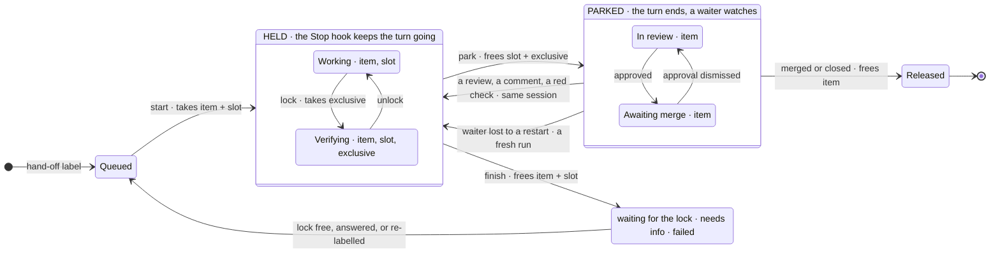

# software-developer

A DAM [starter kit](https://github.com/dam-agents/dam/blob/main/docs/architecture/starter-kits.md):
an agent that takes an issue labelled for implementation, writes the change,
runs the repository's own checks in its sandbox, and drives the pull request
through review.

- [`kit.yaml`](kit.yaml) — what the platform creates: the connection it needs,
  its size, its schedule, and the sandbox it runs in.
- [`CLAUDE.md`](CLAUDE.md) — what the agent does on every run, and what it
  never does.
- [`docs/`](docs/) — the procedures `CLAUDE.md` sends it to when they apply.
- [`ONBOARDING.md`](ONBOARDING.md) — the first conversation, which asks the user
  what only they can answer.
- [`app/`](app/README.md) — the code: one TypeScript CLI, `bin/sd`, that Node
  runs as it is, with its tests. Every script in [`scripts/`](scripts/) is a
  two-line shim onto one of its commands, so the paths a schedule, a hook and
  these docs call never change:
  - `precheck.sh` decides whether a run is worth waking the agent for, before
    any model is involved;
  - `run-state.sh` says which run works on which issue, in which slot, and who
    holds the exclusive lock, and finds and frees a dead run's slot
    ([`docs/runs.md`](docs/runs.md));
  - `session-link.sh` prints the link back to the run that wrote a change,
    which every pull request carries;
  - `work-backup.sh` backs `work/` up to a private repository of its own, and
    restores it on a fresh volume;
  - `harness/claude-code/` holds the `Stop` hook that keeps an unattended run
    from ending its turn until it is at rest — finished, or parked with its
    waiter running — and the installer that registers it and links the skills;
  - `verify-onboarding.sh` checks an instance has the shape onboarding
    promises, and every failure names its fix;
  - `audit.sh` is the deterministic half of the weekly audit;
  - `validate-definition.sh` checks this repository's own shape.

  CI typechecks, lints and tests the app, and validates the definition, on
  every pull request (`npm run check` in `app/`).

**Nothing here names a repository.** Which one to work on, which labels mean
what, and how to build and test it are asked during onboarding and recorded in
`work/CONFIG.md` on the instance; nor any tool: how a repository is set up,
tried out and recovered is that repository's own to document — its
`CLAUDE.md`, skills or contributing guide — and the agent follows it.

**Autonomous or interactive.** Onboarding asks first whether the agent
watches GitHub — implementing what carries the hand-off label and babysitting
its pull requests, unattended — or works only when you ask it in a chat, as a
developer you pair with (`mode` in `work/CONFIG.md`,
[`docs/direct-session.md`](docs/direct-session.md)). Interactive needs no
schedule and only the labels of a claim. Autonomous, both schedules are still
optional: onboarding asks whether to watch the hand-off label and whether to
run the weekly audit.

## An issue's lifecycle

One session carries an issue from its claim to the merge. While it works, it
holds the issue and a slot, and the Stop hook keeps its turn going. While a
person moves — a review, a merge — it **parks**: the slot and the exclusive
lock go back, the issue stays its own, and a waiter wakes that same session
when a review, a comment, a red check or the merge lands
([`docs/babysit.md`](docs/babysit.md)).

## The GitHub connection

The agent acts as whoever the connection belongs to, with everything that
account can reach. **Scope it to the repository the agent works on and nothing
else** — a GitHub App installed on that one repository, or a fine-grained token
limited to it — with read and write on contents, pull requests and issues. The
agent is told never to act on another repository; a connection that cannot is
what keeps that true when an issue body tries to talk it into one. The one
addition is the backup repository, when there is one: write on its contents.

Use a machine account rather than your own: otherwise the pull requests it
opens are indistinguishable from yours.

## Slack

Optional. Bind a channel to the agent in its settings and set `slack_channel`,
and it posts the moments a person acts on there — ready to merge, needs info,
blocked, the weekly audit ([`docs/notify.md`](docs/notify.md)).

It also grills there: open `let's grill <n>` in the channel, answer its
questions in the thread, and approve the breakdown; it files the sub-issues
under #`<n>` with the hand-off label, and the tick implements them
([`docs/slack.md`](docs/slack.md)). Anyone in the channel can grill, so bind
one only trusted people are in. The questions and drafts follow the
repository's own skills when `skill_grill` and `skill_file_issue` name them,
and the definition's defaults in `.agents/defaults/` otherwise.

And it takes hand-offs there: ask it to implement an issue of the repository,
and it puts the hand-off label on it for the tick, as a person with triage
rights would. And it files issues there: ask it to file one, or to fix
something no issue covers, and it files it at once — with the hand-off label
when you asked for the work. `slack_handoff` says who may do either: `anyone`
in the channel, bots and other agents too (the default), `people` only, or
`off`. Asked there to change how it works, it opens a pull request on this
repository directly; a person merges it.

## What it keeps on the instance

All under `work/`, none of it tracked here:

| File | Written by | Holds |
| --- | --- | --- |
| `CONFIG.md` | onboarding | the repository, labels, commands and bounds |
| `AGENTS.md`, `VERSION` | onboarding | a pointer to `CLAUDE.md`; the definition version this instance adopted |
| `items/<n>.md` | `scripts/run-state.sh` | per issue: branch, slot, state, when a run last started on it |
| `slots/<k>/` | `scripts/run-state.sh` | the worktrees runs work in, kept warm between runs |
| `also/<name>/<k>/` | `scripts/run-state.sh` | the same, of a repository `repos_also` names |
| `locks/` | `scripts/run-state.sh` | the item, slot and exclusive locks of live runs |
| `GATE.md` | the precheck, via `run-state.sh` | when it last let a diagnostic run through |
| `TICK.log` | `scripts/run-state.sh` | one line per closed run, append-only |
| `AUDIT.log` | the weekly audit | one line per audit: ok, warn and fail counts |

`CONFIG.md`, `AGENTS.md`, `VERSION` and the two logs are backed up to a
private repository of their own when `work_repo` names one; the rest is
rebuilt from GitHub — [`docs/persistence.md`](docs/persistence.md). The locks
are never backed up, and survive a restart: a resumed turn keeps them.
